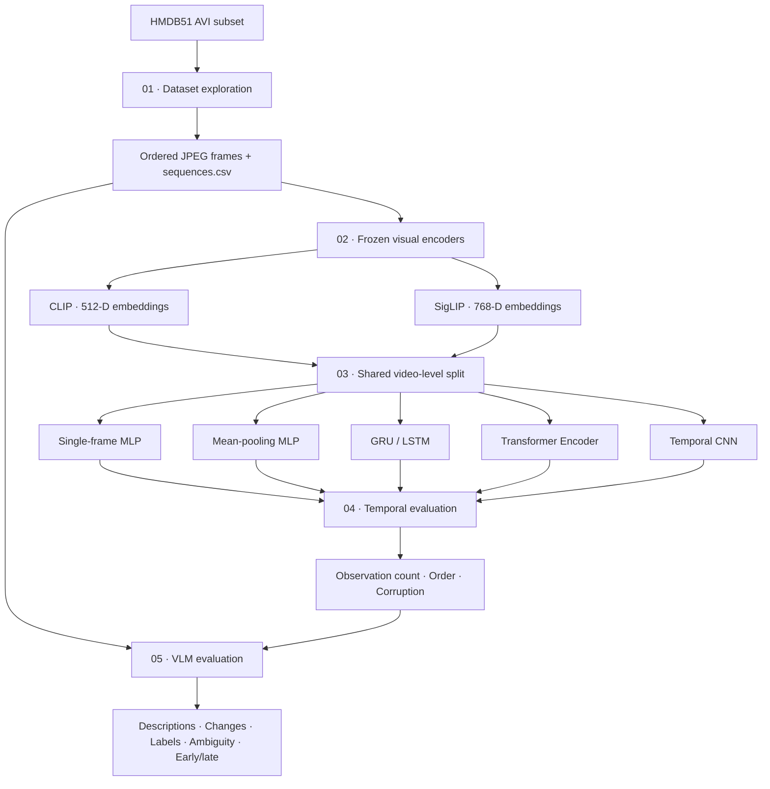

# Temporal Vision: Understanding Actions Through Ordered Visual Observations
> A reproducible video-understanding study comparing single-frame recognition, temporal sequence models, temporal robustness, and vision-language explanations.
**Core question:** Does observing how a scene changes over time improve human-action recognition compared with looking at one frame?
This project uses a manageable local subset of HMDB51, extracts frame-level representations with frozen CLIP and SigLIP image encoders, trains compact classifiers over individual frames and ordered embedding sequences, evaluates temporal robustness, and adds an inference-only Vision-Language Model (VLM) experiment.

## Contents
- [Overview](#overview)
- [Dataset](#dataset)
- [Pipeline](#pipeline)
- [Repository structure](#repository-structure)
- [Environment and setup](#environment-and-setup)
- [Run order](#run-order)
- [Technical methodology](#technical-methodology)
- [Results](#results)
- [Reproducibility](#reproducibility)
- [Limitations](#limitations)
- [Future work](#future-work)

## Overview
The work is organized into five sequential notebooks. Later stages reuse persisted frames, embeddings, splits, and checkpoints rather than repeating earlier processing.
| Notebook | Stage | Main deliverables |
|---|---|---|
| `01_dataset_exploration.ipynb` | Dataset and sequence analysis | Ordered JPEG frames, manifests, statistics, frame strips |
| `02_visual_embeddings_temporal_analysis.ipynb` | Visual representations | CLIP/SigLIP embeddings and temporal analyses |
| `03_single_frame_vs_temporal_modeling.ipynb` | Classification | Baseline/temporal checkpoints, predictions, metrics |
| `04_temporal_evaluation.ipynb` | Controlled evaluation | Progressive observation, order and corruption results |
| `05_vlm_multimodal_evaluation.ipynb` | Multimodal evaluation | VLM outputs, capability metrics, classifier comparison |
### Research questions
1. What changes across a sequence, and when does additional visual information become available?
2. Can an isolated frame be ambiguous when the complete sequence is more informative?
3. How do CLIP and SigLIP representations change across observations and videos?
4. Do temporal models outperform a single-frame baseline?
5. Does mean pooling capture the benefit of multiple frames without using their order?
6. How do observation count, temporal order, and embedding corruption affect predictions?
7. What explanatory value does a VLM add beyond a closed-set visual classifier?

## Dataset
### HMDB51 local subset
The dataset notebook identifies the source mirror as `Sina272/hmdb51-v2`. The original HMDB51 dataset has 51 action classes; the local partial download used here contains **950 AVI videos across nine classes**. Results apply to this subset, not to all 51 classes.
| Action class | Videos |
|---|---:|
| `brush_hair` | 107 |
| `cartwheel` | 107 |
| `catch` | 102 |
| `chew` | 109 |
| `clap` | 130 |
| `climb` | 108 |
| `climb_stairs` | 112 |
| `dive` | 127 |
| `draw_sword` | 48 |
| **Total** | **950** |
### Dataset characteristics
| Property | Observed value |
|---|---:|
| Local AVI files / classes | 950 / 9 |
| Total AVI storage | Approximately 325 MB |
| Frame rate | 30 FPS |
| Mean / median duration | 3.56 s / 2.63 s |
| Duration range | 0.83–24.23 s |
| Frame height | 240 px |
| Frame width | 176–592 px (mean 333.36 px) |
All 950 videos opened and yielded decoded frames. OpenCV's reported frame count matched the decoded count for only four files; 946 had a reported-versus-decoded count discrepancy. This is a decoder/metadata consistency caveat, not 946 failed videos.
### Sampling and sequence integrity
The preprocessing notebook samples up to eight approximately uniformly spaced frames per video and saves JPEGs at quality 95. Each observation retains its original frame index, sampled position, timestamp, video ID, label, and path.
- Total saved frames: **6,662**.
- 938 videos have seven saved frames; 12 have eight.
- 950 ordered video sequences are represented.
- The embedding stage checks strictly increasing frame indices and duplicate indices.
- Later notebooks reuse these saved JPEGs.
Expected input layout:

```text
data/
└── hmdb51/
    ├── videos/
    │   ├── brush_hair/*.avi
    │   ├── cartwheel/*.avi
    │   ├── catch/*.avi
    │   ├── chew/*.avi
    │   ├── clap/*.avi
    │   ├── climb/*.avi
    │   ├── climb_stairs/*.avi
    │   ├── dive/*.avi
    │   └── draw_sword/*.avi
    ├── metadata_train.csv
    ├── metadata_test.csv
    └── metadata_other.csv

```
Metadata files are used to compare listed videos with local files. A metadata row does not guarantee that its video has been downloaded.

## Pipeline



## Repository structure
The notebooks are the executable source of truth. Generated directories are created as the corresponding notebooks run.

```text
Tracking/
├── 01_dataset_exploration.ipynb
├── 02_visual_embeddings_temporal_analysis.ipynb
├── 03_single_frame_vs_temporal_modeling.ipynb
├── 04_temporal_evaluation.ipynb
├── 05_vlm_multimodal_evaluation.ipynb
├── data/
│   ├── hmdb51/
│   └── processed/
│       ├── frames/<class>/<video_id>/frame_*.jpg
│       ├── sequences.csv
│       ├── dataset_manifest.csv
│       └── video_stats.csv
├── embeddings/
│   ├── embedding-store/{clip,siglip}/
│   │   ├── frame_embeddings.npy
│   │   ├── frame_manifest.csv
│   │   └── embedding_metadata.json
│   ├── cosine-similarity/
│   ├── sequence-similarity/
│   ├── temporal-trajectory/
│   ├── temporal-pooling/
│   └── embedding_analysis_summary.json
├── Single-multiframe/
│   ├── Baseline/{clip,siglip}/
│   ├── Temporal/{GRU,LSTM,Transformer_Encoder,Temporal_CNN}/
│   ├── Evaluation/
│   └── data-splits/
├── Temporal-Evaluation/
│   ├── Progressive_Observation/
│   ├── Temporal_Order/
│   ├── Observation_Corruption/
│   ├── Summary/
│   └── experiment_provenance.json
└── VLM-Evaluation/
    ├── Pilot/
    ├── VLM_Outputs/
    ├── Classifier_Comparison/
    ├── Analysis/
    └── Logs/

```
Important artifacts include embedding arrays and manifests, `video_level_splits.csv`, `best_model.pt`, training histories, test predictions, confusion matrices, temporal-evaluation CSVs/plots, VLM raw JSON, parsed results, and provenance files.

## Environment and setup
The notebooks were developed around **Python 3.11**. The VLM provenance records Python 3.11.15 on macOS 15.7.4 ARM64 with an Apple Silicon MLX backend.
### 1. Create and activate an environment

```bash
python3.11 -m venv .venv
source .venv/bin/activate
python -m pip install --upgrade pip

```
Windows activation:

```powershell
.venv\Scripts\activate

```
### 2. Install dependencies

```bash
pip install numpy pandas matplotlib seaborn tqdm opencv-python pillow scikit-learn torch torchvision transformers jupyter ipykernel

```
For the VLM stage on supported Apple Silicon hardware:

```bash
pip install mlx mlx-vlm

```
The embedding and classifier notebooks select CUDA, Apple MPS, or CPU where available. The VLM notebook uses MLX and is not a generic CUDA/CPU configuration.
### 3. Register and start Jupyter

```bash
python -m ipykernel install --user --name temporal-vision --display-name "Python (Temporal Vision)"
jupyter lab

```
Select the `Python (Temporal Vision)` kernel for all notebooks.

## Run order
Run all five notebooks from the project root, in order. Before running, place the videos and metadata under `data/hmdb51/`, keep original AVI files unchanged, and confirm that the active kernel is the project environment.
Some notebooks contain a machine-specific default project path (`/Users/vanshikaarora/Desktop/Tracking`). Update `PROJECT_ROOT` or `PROJECT_ROOT_OVERRIDE` when running elsewhere.
| Order | Notebook | What it does | Required output for next stage |
|---:|---|---|---|
| 1 | `01_dataset_exploration.ipynb` | Discovers videos/metadata, inspects decoding and statistics, extracts frames, creates strips and manifests | `data/processed/sequences.csv` and JPEG frames |
| 2 | `02_visual_embeddings_temporal_analysis.ipynb` | Validates frames, extracts or reuses embeddings, analyzes similarity, PCA trajectories and pooling | `embeddings/embedding-store/clip/` and `siglip/` |
| 3 | `03_single_frame_vs_temporal_modeling.ipynb` | Builds ordered sequences, creates shared split, trains 12 models, evaluates and saves checkpoints | `Single-multiframe/` including splits and checkpoints |
| 4 | `04_temporal_evaluation.ipynb` | Reloads saved checkpoints and runs progressive, order and corruption tests; no retraining | `Temporal-Evaluation/` |
| 5 | `05_vlm_multimodal_evaluation.ipynb` | Samples up to five chronological frames/video, runs pilot and test inference, parses responses and compares labels | `VLM-Evaluation/` |
**Do not independently regenerate the split in later notebooks.** Notebook 03 writes `Single-multiframe/data-splits/video_level_splits.csv`; Notebooks 04 and 05 reuse it.
Notebook 02 has a cache check and defaults to `FORCE_REEXTRACT = False`. It reuses the embedding store when the saved manifest matches the current frame inputs. Notebook 04 evaluates saved checkpoints and does not regenerate embeddings or retrain models. Notebook 05 uses `RUN_FULL_TEST_SET` and `MAX_TEST_VIDEOS` to control the inference run.

## Technical methodology
### 1. Dataset and sequence analysis
The first notebook treats each video as an ordered sequence. Its manifest preserves:
| Field | Meaning |
|---|---|
| `video_id` | Source video identifier |
| `label` | Action class |
| `frame_index` | Original frame index |
| `frame_position` | Position in the extracted sample |
| `timestamp_sec` | Timestamp derived from FPS |
| `frame_path` | Persisted JPEG location |
The notebook checks metadata-to-file correspondence, decoding, FPS, dimensions, duration, frame counts, ordering, duplicates, and missing files. It creates temporal frame strips and early/middle/late comparisons.
The sequence-inspection worksheet is a human-review aid. Specific manually verified examples of ambiguity or temporal usefulness should only be claimed after the worksheet has been completed.
### 2. Visual representations and embedding analysis
Two pretrained image encoders are used independently and remain frozen:
| Encoder | Model ID | Dimensions |
|---|---|---:|
| CLIP | `openai/clip-vit-base-patch32` | 512 |
| SigLIP | `google/siglip-base-patch16-224` | 768 |
Each JPEG is encoded independently. Embeddings are L2-normalized and stored in `.npy` files. `frame_manifest.csv` preserves the row-to-frame association.
The notebook performs four analyses:
- **Consecutive-frame cosine similarity:** similarity between adjacent sampled observations within a video.
- **Video-to-video similarity:** similarity between mean-pooled video representations.
- **Temporal trajectories:** PCA projections of per-frame embeddings in chronological order.
- **Temporal pooling:** mean and max aggregation into video-level representations.
For L2-normalized vectors, cosine similarity is equivalent to the dot product up to floating-point precision. CLIP and SigLIP vectors are not directly compared with each other because their dimensions and feature spaces differ. These analyses describe pretrained image representations; they do not by themselves demonstrate learned motion understanding.
### 3. Single-frame and temporal classifiers
One shared stratified split is created at the **video level** and reused across both encoders and all models:
| Split | Videos |
|---|---:|
| Train | 664 |
| Validation | 143 |
| Test | 143 |
| **Total** | **950** |
Frames from one video never cross split boundaries.
Six approaches are trained independently for CLIP and SigLIP:
| Model | Input / operation | Purpose |
|---|---|---|
| Single-frame MLP | Deterministic middle-frame embedding | Static visual baseline |
| Mean-pooling MLP | Mean of all frame embeddings | Multi-frame, order-agnostic control |
| GRU | Ordered frame embeddings | Recurrent sequence representation |
| LSTM | Ordered frame embeddings | Gated recurrent sequence representation |
| Transformer Encoder | Ordered embeddings + positional embeddings | Self-attention over observations |
| Temporal CNN | Ordered embeddings | Temporal convolutional patterns |
#### Architecture summary
- **MLP:** input → 256 → 128 → number of classes, with ReLU and dropout.
- **GRU/LSTM:** project each frame to 128 dimensions; one unidirectional recurrent layer with hidden size 128; classify the final valid hidden state. Packed sequences preserve true lengths.
- **Transformer:** project to 128 dimensions; learned positional embeddings; two encoder layers, four attention heads, feed-forward dimension 256, padding mask, and masked mean pooling of valid token outputs.
- **Temporal CNN:** project to 128 channels; two residual 1D convolution blocks (kernel size 3, dilation rates 1 and 2); masked temporal average; classification head.

#### Training configuration
| Setting | Value |
|---|---:|
| Seed | 42 |
| Batch size | 32 |
| Maximum epochs | 60 |
| Early-stopping patience | 10 |
| Optimizer | AdamW |
| Learning rate | 0.001 |
| Weight decay | 0.0001 |
| Dropout | 0.25 |
| Loss | Class-weighted cross-entropy |
| Checkpoint selection | Best validation macro-F1 |
| Gradient clipping | Maximum norm 1.0 |
Only compact classifiers/temporal modules are trained; the visual encoders are not fine-tuned.

### 4. Temporal evaluation
Notebook 04 reloads the exact split and saved checkpoints. It does not retrain models.
**A. Progressive observation**
Temporal models receive uniformly sampled subsets containing `k = 1…7` observations. `k=1` selects the middle frame; larger values sample across the timeline. The fixed single-frame baseline remains a middle-frame reference, and mean pooling is an order-agnostic control. Checkpoints trained on full sequences are evaluated on reduced inputs without retraining; this is an observation-budget test, not a separately trained model for each `k`.
**B. Temporal order**
Each temporal checkpoint is evaluated using chronological order, reversed order, and 20 independently shuffled permutations per video. The same weights and test videos are used. Mean and standard deviation across shuffled repetitions quantify variability. Single-frame and mean-pooling models are excluded because they are order-invariant by construction.
**C. Observation corruption**
Only cached embeddings are available in this stage, so the notebook applies feature/observation perturbations rather than pixel-space blur or physical occlusion.
| Perturbation | Severity | Operation |
|---|---|---|
| Frame dropping | Retain 75%, 50%, 25% | Randomly retain frames in chronological order; keep at least one |
| Feature masking | Mask 25%, 50%, 75% | Set randomly selected embedding dimensions to zero |
| Gaussian noise | 0.10, 0.25, 0.50 | Add zero-mean noise scaled by per-dimension training feature standard deviation |
Noise scale is estimated from training videos only. Stable per-video random seeds make perturbations reproducible. For the single-frame baseline, frame dropping is not applicable; its selected middle observation remains the only input. Feature masking and noise are applied to that embedding.

### 5. Multimodal VLM evaluation
Notebook 05 is inference-only; no fine-tuning is performed. It samples up to five chronological source frames per held-out test video and prompts the VLM for structured outputs covering all five requested capabilities:
1. Sequence-level description.
2. Temporal change analysis.
3. Semantic action labeling.
4. Identification of ambiguous observations.
5. Early-versus-later observation comparison.
The notebook includes contact-sheet inspection, a small pilot, response parsing, incremental checkpointing, raw-response preservation, latency recording, semantic metrics, classifier comparison, and provenance logging.
**Complementary roles:** visual classifiers provide fast closed-set predictions and class probabilities. The VLM can provide natural-language descriptions, temporal comparisons, semantic context, and explicit uncertainty notes. VLM responses are slower and can be malformed or visually inaccurate, so outputs should be checked against sampled frames.

## Results
Results below are from the current nine-class subset and fixed 143-video test split. They are point estimates from one split.

### Single-frame vs temporal classification
| Model | CLIP accuracy | CLIP macro-F1 | SigLIP accuracy | SigLIP macro-F1 |
|---|---:|---:|---:|---:|
| Single-frame | 94.41% | 0.9479 | **97.20%** | **0.9746** |
| Mean pooling | 97.20% | 0.9753 | 95.10% | 0.9555 |
| GRU | 94.41% | 0.9478 | 93.71% | 0.9443 |
| LSTM | 93.71% | 0.9425 | 93.71% | 0.9379 |
| Transformer Encoder | **98.60%** | **0.9873** | 95.10% | 0.9561 |
| Temporal CNN | 96.50% | 0.9668 | 95.80% | 0.9621 |
- **Best CLIP result:** Transformer Encoder — 98.60% accuracy, 0.9873 macro-F1.
- **Best SigLIP result:** Single-frame baseline — 97.20% accuracy, 0.9746 macro-F1.
Temporal modeling improves the CLIP Transformer result over its single-frame baseline, but does not improve the SigLIP single-frame baseline. CLIP mean pooling is also strong, indicating that aggregating multiple observations can help without necessarily learning chronological relationships.

### Temporal-order results
| Encoder / model | Chronological F1 | Reversed F1 | Shuffled mean F1 | Shuffled std |
|---|---:|---:|---:|---:|
| CLIP Transformer | 0.9873 | 0.9811 | 0.9805 | 0.0052 |
| SigLIP Transformer | 0.9561 | 0.9496 | 0.9534 | 0.0034 |
For the CLIP Transformer, chronological order has a 0.68 percentage-point macro-F1 advantage over the shuffled mean. This is modest; order perturbations do not consistently reduce performance across architectures.

### VLM results
The VLM evaluated all 143 accessible test videos.
| Metric | Result |
|---|---:|
| Valid structured outputs | 114 / 143 (79.72%) |
| Parse errors | 29 / 143 (20.28%) |
| Runtime errors | 0 |
| Class-label coverage | 66.43% |
| Accuracy among emitted class labels | 85.26% |
| Accuracy with `uncertain/other` counted wrong | 56.64% |
| `uncertain/other` rate | 33.57% |
| Median latency in semantic metrics | 13.50 s |
Non-empty output coverage was 79.72% for sequence description, temporal changes, semantic labels, and early/later comparison. Ambiguous-observation identification had 76.22% coverage.
Conditional emitted-label accuracy and accuracy counting abstentions as wrong should be reported together. VLM and supervised classifiers are not like-for-like benchmarks: their training/prompting setups differ, and the VLM can abstain.

> **Model provenance check:** the VLM notebook prose names `mlx-community/Qwen2.5-VL-3B-Instruct-4bit`, but the executed `MODEL_ID` and provenance record `mlx-community/Qwen2-VL-2B-Instruct-4bit`, while `MODEL_FAMILY` says `Qwen2.5-VL-3B-Instruct`. Verify the runtime model ID before reproducing or externally reporting this configuration.

## Reproducibility
The notebooks include the following safeguards:
- Seed `42` for the principal experiments.
- Video-level splits; no frames from a video cross splits.
- The same saved split across encoders, architectures, evaluation, and VLM stages.
- Frozen CLIP/SigLIP encoders.
- Validation macro-F1 for checkpoint selection; test data reserved for final evaluation.
- Cached frames and embeddings with row-aligned manifests.
- Checks for sequence order, duplicate indices, missing frames, embedding dimensions, finite values, and manifest/vector row counts.
- Saved configurations, paths, split details, model metadata, and runtime provenance.
- Raw VLM responses retained alongside parsed results and error statuses.
For reproducibility, retain the split CSV, checkpoints, manifests, provenance JSON, and package/runtime versions together with the reported metrics.

## Limitations
1. **Partial dataset:** nine of 51 HMDB51 classes, uneven class counts, and a subset determined by the local download.
2. **Small test set:** 143 videos and one split; no repeated-seed estimates or confidence intervals.
3. **Sparse sampling:** seven or eight frames/video can miss brief events and do not represent continuous motion.
4. **Decoder metadata:** reported and decoded frame counts differ for 946 files, although all 950 yielded decoded frames.
5. **Frozen image encoders:** temporal models operate on embeddings, not raw video, optical flow, or learned spatiotemporal patches.
6. **Order sensitivity:** strong classification scores do not prove reliance on chronological order; observed sensitivity is modest and model-dependent.
7. **Embedding corruption:** feature masking/noise are not pixel blur, physical occlusion, or real-world image degradation.
8. **Qualitative annotation:** the sequence-inspection worksheet is a review template; specific manually verified examples require human completion.
9. **VLM reliability:** 20.28% parse errors, semantic abstentions, and possible hallucinations require review.
10. **VLM metadata:** model identifier and family fields are inconsistent and need verification.

## Future work
- Expand to more HMDB51 classes and a broader, more balanced subset.
- Repeat video-level experiments across seeds and report confidence intervals or paired bootstrap estimates.
- Complete human-reviewed early/middle/late annotations.
- Increase temporal sampling density or use adaptive/event-aware frame selection.
- Compare embedding corruption with pixel-space blur, masking, and partial occlusion.
- Investigate motion-specific features, optical flow, and temporal augmentation.
- Test cross-dataset or cross-environment generalization.
- Resolve and record the exact VLM model revision and quantization.
- Improve constrained JSON generation, schema validation, retries, and human review.
- Use the VLM selectively for explanation and ambiguity analysis while retaining compact classifiers for routine closed-set prediction.

## Conclusion
This project implements an end-to-end study of ordered visual observations, from dataset inspection and pretrained frame representations to temporal classifiers, controlled robustness experiments, and VLM-based sequence analysis.
The strongest result is the CLIP Transformer Encoder at **98.73% test macro-F1**. The SigLIP single-frame baseline reaches **97.46%** and outperforms its temporal alternatives. Progressive-observation and order-perturbation results show that additional frames do not guarantee better predictions and that chronological order is not equally important to every model.
**The evidence supports a conditional benefit from multi-observation modeling—not a blanket claim that more frames or temporal architectures are always better.**

## Citation and acknowledgements
- **Dataset:** HMDB51 human action recognition dataset; local partial mirror identified in the notebook as `Sina272/hmdb51-v2`.
- **Visual encoders:** OpenAI CLIP (`openai/clip-vit-base-patch32`) and Google SigLIP (`google/siglip-base-patch16-224`).
- **VLM:** Qwen2-VL/Qwen2.5-VL 4-bit MLX configuration as recorded in Notebook 05. Verify the exact model ID in runtime provenance before citing a specific checkpoint.
Please cite the original dataset and model publications/model cards when using this work in an academic or public research context.
