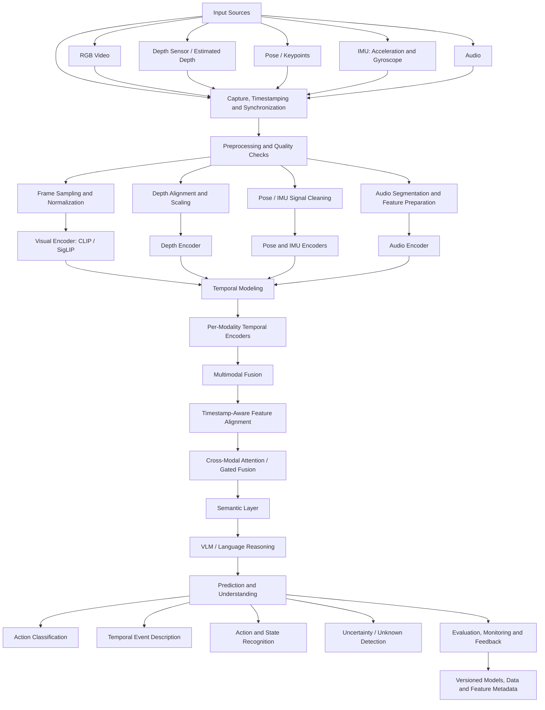

# 8. System Design: Scalable Multimodal Perception Architecture

## 8.1 Architecture overview

The current project establishes a video-understanding pipeline using sampled RGB frames, frozen CLIP/SigLIP visual representations, temporal classifiers, and an inference-only VLM evaluation component. The architecture below describes how this experiment could evolve into a larger multimodal perception system.

The proposed system keeps the current RGB video pathway as its foundation and adds optional modalities—such as depth, pose, IMU, and audio—when they provide complementary information. The diagram is a **proposed system design**, not a claim that all these modalities have already been implemented in the current project.

## 8.2 Design choices

### 1. Visual input as the primary pathway

RGB video remains the primary input because it is the modality available in the current HMDB51 experiment. Frames are sampled with their original timestamps and video identifiers preserved. This maintains the sequence structure required for temporal analysis and allows the existing CLIP and SigLIP embedding pipeline to remain reusable.

### 2. Add complementary modalities only where useful

The additional modalities are intended to address information that RGB alone may not represent reliably:

- **Depth:** provides geometric and distance cues, which can help distinguish actions involving spatial movement or object interaction.
- **Pose / keypoints:** represents body configuration and joint movement explicitly, potentially helping when action identity depends on body motion.
- **IMU:** provides direct motion measurements such as acceleration and angular velocity. It is most relevant when the system has access to wearable or device-mounted sensors.
- **Audio:** can provide environmental sounds, speech, or action-related acoustic cues that may complement visual observations.

These inputs are optional because a practical system should not fail simply because a sensor is unavailable. Each modality should carry an availability mask and data-quality metadata.

### 3. Modality-specific representation

Each modality is first processed by a suitable encoder rather than being combined as raw input. The RGB pathway can reuse the frozen CLIP/SigLIP representations from the current project. Depth, pose, IMU, and audio would use encoders appropriate to their data types.

Keeping modality-specific encoders separate preserves the structure of each signal and makes it possible to evaluate the contribution of each modality independently.

### 4. Temporal modeling before multimodal fusion

Each modality has its own temporal characteristics and sampling rate. For example, video frames, audio segments, and IMU readings may arrive at different frequencies. Per-modality temporal encoders can model these sequences before their representations are aligned and fused.

The system should preserve timestamps and use a common event timeline. Missing or delayed observations should be handled explicitly rather than silently treated as valid synchronized data.

### 5. Timestamp-aware multimodal fusion

After temporal encoding, modality representations are aligned using timestamps and fused. A practical design is **gated fusion or cross-modal attention**:

- Gated fusion can reduce the influence of an unreliable or unavailable modality.
- Cross-modal attention can learn relationships between modalities, such as visual movement occurring alongside an audio event or a change in pose.

Fusion should support missing modalities and include modality-availability indicators. This avoids requiring every deployment environment to provide every sensor.

### 6. Semantic / VLM layer

The fused representation can be passed to a semantic layer that combines task-specific prediction heads with a VLM. The prediction heads provide structured outputs such as action classes or event boundaries. The VLM can use visual and multimodal evidence to produce higher-level descriptions and explanations.

The VLM should be grounded in the available observations and structured model outputs. It should not be treated as a replacement for measurable classifiers or as proof that an event occurred when the sensor evidence is ambiguous.

### 7. Prediction, uncertainty and monitoring

The final layer can provide:

- Action classification and confidence scores.
- Temporal event descriptions or event intervals.
- Recognition of relevant body or scene states.
- An uncertainty or unknown outcome when the evidence is insufficient.

Predictions should retain links to the source video, timestamps, model versions, and modality availability. This makes results auditable and supports error analysis.

## 8.3 How the design evolves from the current experiment

| Current project component | Proposed system evolution |
|---|---|
| Sampled RGB frames from HMDB51 | Timestamped RGB stream with optional synchronized sensor inputs |
| Frozen CLIP and SigLIP embeddings | Reusable visual encoder plus modality-specific depth, pose, IMU and audio encoders |
| MLP, GRU, LSTM, Transformer and Temporal CNN comparisons | Per-modality temporal encoders followed by timestamp-aware multimodal fusion |
| Mean pooling and frame-order evaluations | Controlled temporal and cross-modal ablations |
| Inference-only VLM evaluation | Grounded semantic layer operating on fused evidence and structured predictions |
| Classification metrics and saved experiment outputs | End-to-end evaluation, uncertainty analysis, monitoring and versioned provenance |

## 8.4 Evaluation strategy for the larger system

The multimodal architecture should be evaluated through controlled ablation experiments rather than assuming that adding sensors will improve performance.

1. **RGB-only baseline:** evaluate the existing visual pipeline.
2. **Single-modality additions:** add depth, pose, IMU, or audio one at a time.
3. **Multimodal combinations:** evaluate selected combinations after measuring each modality independently.
4. **Missing-modality tests:** remove one modality at inference time and measure robustness.
5. **Synchronization tests:** introduce realistic timestamp offsets or dropped observations to assess sensitivity to alignment errors.
6. **Temporal-order tests:** compare chronological, reversed, and shuffled sequences using identical observations.
7. **Efficiency tests:** measure latency, memory use, and throughput as modalities and model components are added.

All comparisons should use the same video-level data splits and report macro-F1, accuracy, per-class performance, and variation across repeated runs where feasible.

## 8.5 Summary

The proposed architecture extends the current RGB-based temporal video-classification experiment into a modular multimodal perception system. Its central design principle is to **encode each modality appropriately, preserve temporal information, align observations by timestamp, and fuse only the information that is available and reliable**. A grounded semantic/VLM layer can then convert the fused evidence into predictions and descriptions, while uncertainty handling and controlled ablations keep the system measurable and auditable.

The additional modalities and fusion components are proposed extensions; the current project results are based on RGB video embeddings and the evaluated temporal and VLM components described in the experiment notebooks.
